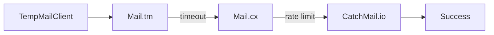
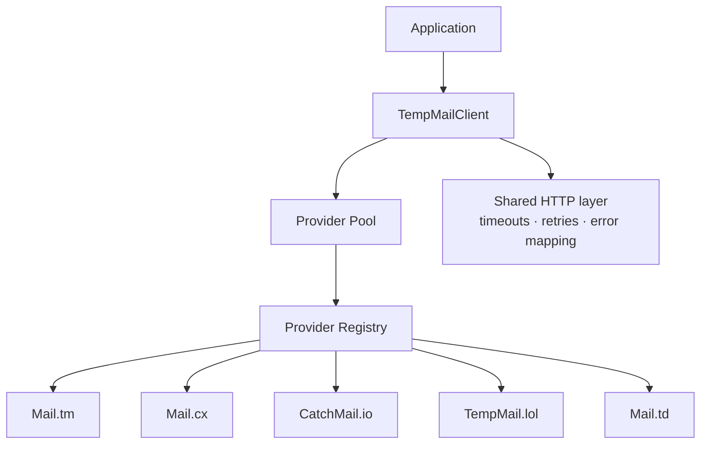
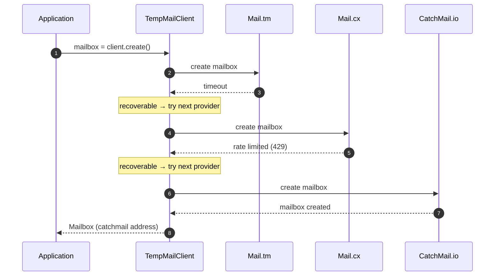

# MultiTempMail

> Unified temporary email SDK for Python with automatic provider failover.

[](https://github.com/0xdzik/multitempmail/blob/main/LICENSE)
[](https://github.com/0xdzik/multitempmail/actions/workflows/ci.yml)
[](https://codecov.io/gh/0xdzik/multitempmail)
[](https://github.com/astral-sh/ruff)
[](https://mypy-lang.org/)
[](https://pypi.org/project/multitempmail/)
[](https://pypi.org/project/multitempmail/)

---

## Why MultiTempMail?

Wrappers for a single temporary email provider break the moment that
provider is down, rate-limited, or disappears. `multitempmail` treats
temporary email as one problem, not five:

- **one API** — the same `TempMailClient`, models, exceptions and helpers
  for every provider; swap providers without changing your code
- **multiple providers** — mail.tm, catchmail.io, tempmail.lol, mail.cx
  and mail.td behind a dynamic registry
- **automatic failover** — the default client pools every provider and
  falls through on transient failures in priority order
- **provider health management** — failing providers are demoted
  automatically and recover after a successful request
- **production-ready architecture** — shared HTTP layer (timeouts,
  retries, proxy), typed models, one error hierarchy, 185-test suite with
  fully mocked HTTP

## Features

- [x] Automatic provider failover
- [x] Unified API for 5 providers
- [x] Provider health management
- [x] Wait utilities with cancellation (`wait_for_otp`, `wait_for_link`, ...)
- [x] OTP extraction (`123456`, `123-456`, `ABC123`, custom regex)
- [x] Verification link extraction (domain / keyword / custom filters)
- [x] Session persistence (JSON save / restore)
- [x] Response cache (TTL, auto-invalidation)
- [x] CLI (`create`, `inbox`, `otp`, `providers`, ...)
- [x] Type hints (mypy-strict)
- [x] Comprehensive test suite (185 tests, mocked HTTP)

## Installation

```bash
pip install multitempmail
```

Requires Python ≥ 3.10. Runtime dependency: `httpx` only.

```python
from multitempmail import TempMailClient
```

## Quick Start

```python
client = TempMailClient("mailtm")
mailbox = client.create()
print(mailbox.address)                     # e.g. k9f2x7q1@some-domain.tm

otp = mailbox.wait_for_otp(timeout=120)    # blocks until a code arrives
print(f"code: {otp}")                      # e.g. 483920
```

Or with the CLI:

```bash
multitempmail create --provider catchmail --save session.json
multitempmail otp --timeout 60 --session session.json
```

## Supported Providers

| Provider     | Setup                              | Attachments | Server wait | Mark read | Status |
|--------------|------------------------------------|:-----------:|:-----------:|:---------:|:------:|
| Mail.tm      | none (account + token created for you) | ✓         |             | ✓         | Active |
| CatchMail.io | none — mailbox is implicit         | ✓           |             |           | Active |
| TempMail.lol | optional Plus/Ultra API key        |             | ✓ (long-poll) |         | Active |
| Mail.cx      | optional token for higher limits   | ✓           | ✓ (25s hold) |           | Active |
| Mail.td      | API token required (Pro)           | ✓           |             | ✓         | Active |

Provider names are case-insensitive; `mail.tm`, `mail.cx`, `mail.td`,
`tempmail.lol` and `catchmail.io` aliases work everywhere.

### Capability matrix

| Provider     | create | list | read | delete msg | delete mailbox | mark read | attachments | server wait | domain select |
|--------------|:------:|:----:|:----:|:----------:|:--------------:|:---------:|:-----------:|:-----------:|:-------------:|
| mailtm       |   ✓    |  ✓   |  ✓   |     ✓      |       ✓        |     ✓     |      ✓      |             |       ✓       |
| catchmail    |   ✓    |  ✓   |  ✓   |     ✓      |                |           |      ✓      |             |               |
| tempmail_lol |   ✓    |  ✓   |      |     ✓      |       ✓        |           |             |      ✓      |               |
| mailcx       |   ✓    |  ✓   |  ✓   |     ✓      |       ✓*       |           |      ✓      |      ✓      |               |
| mailtd       |   ✓    |  ✓   |  ✓   |     ✓      |       ✓        |     ✓     |      ✓      |             |       ✓       |

`*` mail.cx has no mailbox deletion; `delete_mailbox()` clears every email
at the address (documented behavior). Unsupported operations raise
`UnsupportedFeature` (a `TempMailError`).

## CLI

A `multitempmail` command ships with the package (no extra dependencies):

```bash
multitempmail create --provider catchmail --save session.json
multitempmail inbox --session session.json
multitempmail read <message-id> --session session.json
multitempmail otp --timeout 60 --session session.json
multitempmail wait --subject confirm --session session.json
multitempmail providers
multitempmail health
```

| Command      | What it does                                   |
|--------------|------------------------------------------------|
| `create`     | Create a mailbox, save it to a session file    |
| `inbox`      | List messages                                  |
| `read ID`    | Print one message                              |
| `otp`        | Wait for and print a verification code         |
| `wait`       | Wait for a message (`--subject` / `--sender` / `--otp` / `--link`) |
| `delete`     | Delete a message (`--mailbox` clears the inbox)|
| `providers`  | List providers, capabilities and priorities (`--json`) |
| `domains`    | List available domains                         |
| `health`     | Show provider health (`--json`)                |

`create` writes a session file (default `session.json`); other commands
load it, creating a fresh mailbox on demand if none was saved. The CLI is
a thin wrapper over the SDK — no duplicated logic.

## Provider Selection

This is the core selling point: **one call, five providers, automatic
failover.**



```python
client = TempMailClient()          # pools every provider
mailbox = client.create()          # first provider that succeeds
```

### How it works

| Provider     | priority | notes                             |
|--------------|:--------:|-----------------------------------|
| Mail.tm      |   100    | default, tried first              |
| Mail.cx      |    95    |                                   |
| CatchMail.io |    90    | no setup — good failover fallback |
| TempMail.lol |    85    |                                   |
| Mail.td      |    60    | needs an API key                  |

- Providers are tried highest **effective priority** first. `priority` is
  static; the health manager adjusts it live — each consecutive failure
  costs 20 points (capped), one successful request restores it fully.
- **Recoverable failures** (rate limit, timeout, transport error, 5xx)
  advance to the next provider; **permanent errors** (invalid parameters,
  bad credentials, 404/410) raise `FailoverError` immediately.
- Providers without credentials skip themselves automatically (e.g. a
  mail.td pool with no `api_key` just moves on).
- `client.providers()` lists static metadata; `client.health()` shows live
  health per provider (failure streaks, average response time, effective
  priority).

## Advanced Usage

### Selecting providers explicitly

```python
client = TempMailClient("mailtm")                # exactly one provider
client = TempMailClient(["mailtm", "mail.cx"])   # a custom set
client = TempMailClient("mail.td", api_key="td_...")
```

### Waiting for mail

All helpers wait **only for mail that arrives after the call** and raise
`TimeoutError` (from `multitempmail.errors`) on expiry. Providers with a
server-side long-poll (tempmail.lol `/wait`, mail.cx 25s hold) use it;
others poll at `interval` seconds (default 2s).

```python
mailbox.wait_for_message(timeout=60)                     # first new message
mailbox.wait_for_subject("confirm", timeout=60)          # subject contains ...
mailbox.wait_for_sender("noreply@example.com")           # sender contains ...
mailbox.wait_for_otp(timeout=120)                        # extract OTP from body
mailbox.wait_for_link(domain="example.com", keyword="reset")

stop = lambda: stop_event.is_set()                       # cancel from another thread
try:
    otp = mailbox.wait_for_otp(timeout=120, stop=stop)
except WaitCancelled:                                    # stop() returned True
    ...
```

OTP extraction tries, in order: 6 digits (`123456`), 6 digits split by
`-`/space/`.` (`123-456` → `123456`, phone numbers excluded), 6 uppercase
alphanumerics with at least one digit and one letter (`ABC123`, not
`ABCDEF`). Pass `pattern=` for a custom shape. Link extraction returns the
first link (trailing punctuation stripped), optionally filtered by
`domain=`, `keyword=` or a custom `filter=callable`.

### Messages and attachments

```python
messages = mailbox.messages()                 # list (summary fields)
full = mailbox.message(messages[0].id)        # fetch full body
mailbox.mark_read(messages[0].id)             # where supported

data = mailbox.download(full, full.attachments[0])
data = mailbox.download(full, 0)              # ... or by index
```

Attachments carry either a `download_url` (mail.tm / catchmail.io) or a
zero-based `index` (mail.cx / mail.td) — `mailbox.download()` handles both.

### Sessions

```python
mailbox = client.create()
client.save_session("session.json")

restored = TempMailClient.load_session("session.json")
restored.active.wait_for_otp(timeout=60)      # mailbox usable again
```

Sessions are JSON files with exactly what is needed to restore the
mailbox (provider names, jsonable options, address/token/password).
`restore_session()` applies a session to an existing client in place.

### Response cache

```python
from multitempmail import ResponseCache

client = TempMailClient(cache=ResponseCache(default_ttl=30))
messages = mailbox.messages()      # cached for 30s
mailbox.delete(messages[0].id)     # write ops invalidate the cache
```

Message lists are cached per mailbox and auto-invalidated on
`delete()` / `mark_read()` / `delete_mailbox()`. Domain listings are
cached per provider. Waiting helpers bypass the cache entirely, so
`wait_for_*` never misses new mail. Providers whose fetch consumes mail
(tempmail.lol) never cache.

### HTTP behavior

Every request goes through one `httpx` client with:

- timeouts (default 30s; long-poll endpoints get larger ones),
- automatic retries for idempotent methods (GET/HEAD/OPTIONS/DELETE/PUT)
  on 408/425/429/5xx or transport errors, exponential backoff (cap 10s),
  honoring `Retry-After`; POSTs are never auto-retried (no duplicate
  accounts),
- optional `proxy=` and a default `User-Agent: multitempmail-sdk/<version>`.

```python
client = TempMailClient("mailtm", timeout=20, retries=5,
                        proxy="http://127.0.0.1:8080")
```

### Errors

All exceptions inherit `TempMailError` and carry `status_code` and the
underlying `response`:

| Exception             | Meaning                                            |
|-----------------------|----------------------------------------------------|
| `AuthenticationError` | 401/403, or missing credentials (e.g. no mail.td key) |
| `MessageNotFound`     | 404 on a message-level operation                   |
| `MailboxExpired`      | 410 (or 404 on mailbox deletion: mail.tm/mail.td)  |
| `RateLimitError`      | 429                                                |
| `TimeoutError`        | request timeout or wait-helper expiry              |
| `WaitCancelled`       | a wait helper's `stop=` callback returned `True` (a `TimeoutError`) |
| `ProviderError`       | any other failure                                  |
| `UnsupportedFeature`  | capability not implemented by the provider         |
| `FailoverError`       | provider pool exhausted / permanent failure; carries `.failures` (name, exception) pairs |

```python
from multitempmail.errors import TempMailError, TimeoutError

try:
    otp = mailbox.wait_for_otp(timeout=60)
except TimeoutError:
    print("no code arrived")
except TempMailError as exc:
    print(f"provider error: {exc} (HTTP {exc.status_code})")
```

## Architecture





- **registry** — providers self-register via `@register(...)`; nothing is
  hardcoded in the client
- **BaseProvider** — declares metadata (name, priority, capabilities) and
  implements endpoints only; all shared behavior lives in core modules
- **shared HTTP layer** — one client per provider (timeouts, retries,
  proxy, error mapping, health metrics); providers never build their own
- **models & errors** — one `Mailbox`/`Message`/`Attachment` model set and
  one exception hierarchy for every provider

### Extending with a new provider

```python
from multitempmail import BaseProvider, register

@register("myprovider")
class MyProvider(BaseProvider):
    name = "myprovider"
    display_name = "My Provider"
    base_url = "https://api.myprovider.example"
    capabilities = frozenset({"create", "list", "read"})
    default_priority = 80                   # failover order
    known_domains = ("mail.myprovider.example",)

    def create(self, **kwargs):
        ...

client = TempMailClient("myprovider")       # now also in TempMailClient()
```

## Contributing

Bug reports, feature requests and pull requests are welcome. See
[`CONTRIBUTING.md`](CONTRIBUTING.md) for setup, verification commands
(`pytest`, `ruff`, `black`, `mypy`) and the new-provider guide.

## Support

Something not working? Check [`SUPPORT.md`](SUPPORT.md) or open a
[GitHub issue](https://github.com/0xdzik/multitempmail/issues) — include
your Python version, package version (`pip show multitempmail`) and a
minimal reproduction. A provider's API changed or broke? Report it; the
plug-in will be updated against the provider's current docs.

## License

MIT — see [`LICENSE`](LICENSE).

---

## Not implemented (future work)

- Custom-domain registration/verification for mail.cx, mail.td and
  tempmail.lol v3 (the endpoints exist server-side; domain *selection* on
  `create()` is supported where documented).
- tempmail.lol v2 endpoints, scoped keys, webhooks.
- mail.cx SSE streaming endpoints.
- Async API (the SDK is structured so a parallel `AsyncProvider` layer can
  reuse the models and error hierarchy).

## Provider docs

- Mail.tm — https://docs.mail.tm
- CatchMail.io — https://catchmail.io/docs
- TempMail.lol — https://api.tempmail.lol (v3)
- Mail.cx — https://mail.cx/api-docs/
- Mail.td — https://docs.mail.td/llms.txt
